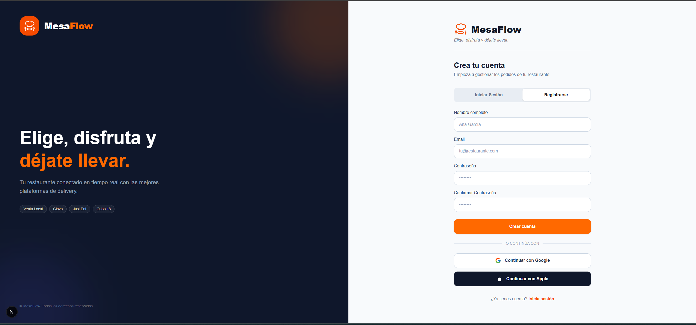
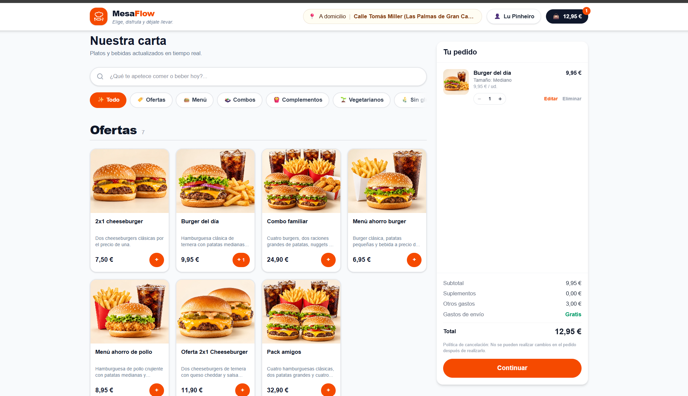
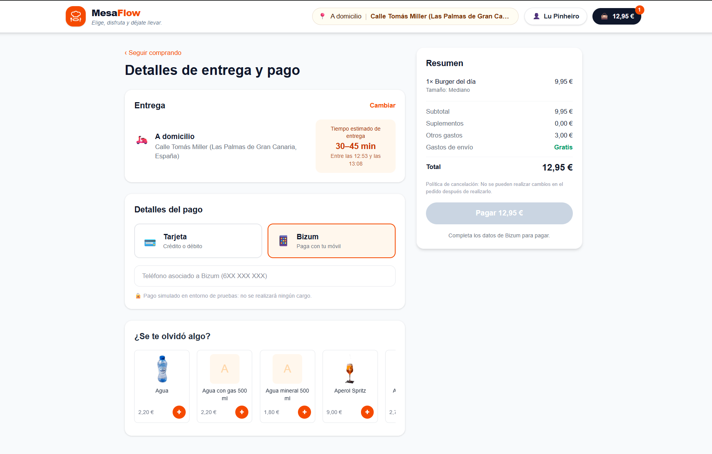
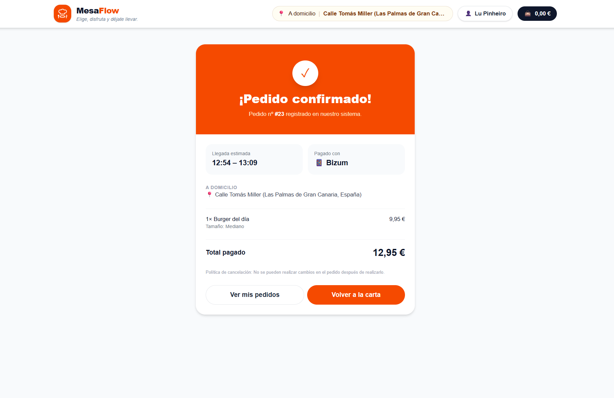
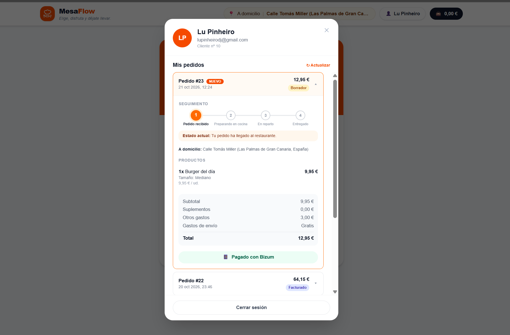
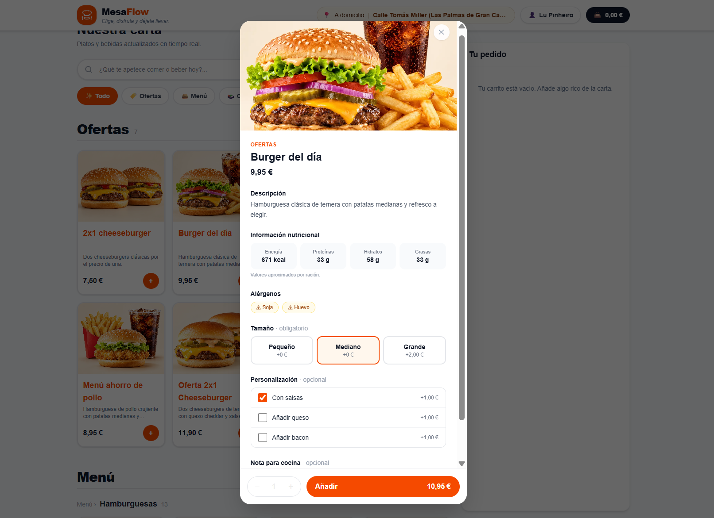
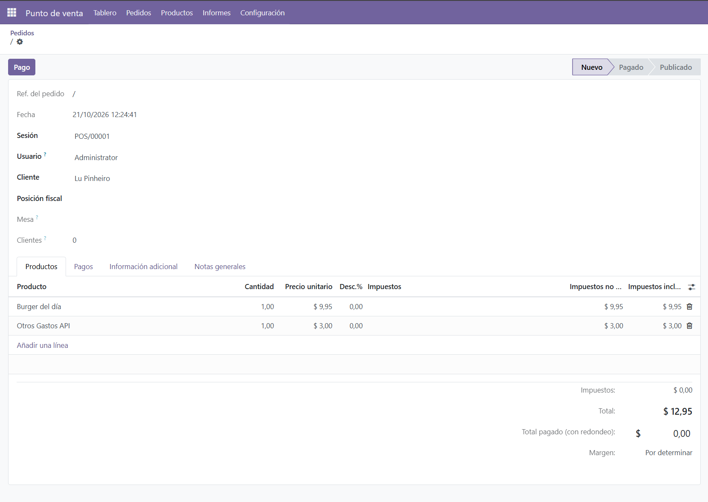

# MesaFlow 🍔 – Headless Food Delivery & Odoo 18 POS Integration

MesaFlow es una solución de e-commerce y delivery enfocada en restauración, estructurada bajo una arquitectura moderna desacoplada (*Headless*). El sistema conecta una interfaz web interactiva con el Punto de Venta (POS) de **Odoo 18** en tiempo real, utilizando una API intermedia (Middleware) construida con **NestJS**.

---

## 📸 Demostración Visual y Flujo del Sistema

A continuación se detalla el flujo completo de la aplicación, desde la experiencia del usuario final en la web hasta el impacto contable e inventariado en el backend de Odoo ERP.

### 1. Portal de Acceso y Omnicanalidad (Landing & Auth)
La aplicación cuenta con una pantalla de bienvenida y pasarela de autenticación optimizada para la gestión de usuarios y canales de venta.

* **Landing Page y Registro Integrado:** Interfaz de acceso limpia con soporte para inicio de sesión clásico o mediante proveedores (Google y Apple). Destaca visualmente el ecosistema omnicanal conectado (Venta Local, Glovo, Just Eat y Odoo 18).
<p align="center">
  
</p>

---

### 2. Interfaz de Usuario e Interactividad (Frontend)
La plataforma web ofrece una experiencia fluida y reactiva para el consumidor, sincronizando dinámicamente los datos críticos del negocio.

* **Carta Principal Dinámica:** Catálogo de productos organizado por categorías, precios actualizados y banners de ofertas sincronizados en tiempo real desde el ERP.
<p align="center">
  
</p>

* **Ficha de Producto y Alérgenos:** Modal interactiva que recupera las variantes obligatorias (tamaños) y la información nutricional. Incluye un control estricto de alérgenos asociados directamente a la ficha del producto en el backend.
<p align="center">
  
</p>

---

### 3. Pasarela de Pago y Flujo de Pedidos
El proceso de checkout simula un entorno de producción real garantizando la usabilidad del sistema de pedidos.

* **Detalles de Entrega y Pago:** Formulario optimizado con cálculo de tiempos estimados de reparto. Soporta pasarelas de pago modernas como tarjeta de crédito y Bizum (simulado en entorno de pruebas).
<p align="center">
  
</p>

* **Confirmación Inmediata:** Interfaz de éxito que proporciona al usuario el número de orden (`Pedido nº 23`) registrado e inyectado con éxito en el ecosistema de la empresa.
<p align="center">
  
</p>

* **Panel de Seguimiento Asíncrono (Order Tracking):** Pantalla en tiempo real que permite al cliente monitorizar el estado de su comida en cocina o reparto. Cambia dinámicamente mediante eventos desde el servidor.
<p align="center">
  
</p>

---

### 4. Sincronización e Inyección en Odoo POS (Backend)
Demostración de la arquitectura desacoplada: el pedido de la web se inyecta directamente como un ticket en el ERP de la empresa.

* **Backend Odoo 18 POS:** Registro automático del ticket dentro de la sesión activa del Punto de Venta (`POS/00001`). Mapea el cliente (`Lu Pinheiro`), calcula los impuestos correspondientes e inyecta las líneas de servicio dinámicas como "Otros Gastos API" por recargo logístico de reparto.
<p align="center">
  
</p>

---

## 🚀 Características Clave
* **Arquitectura Desacoplada (Headless):** Separación total de la capa visual y las reglas de negocio/ERP para un rendimiento óptimo.
* **Orquestación con NestJS:** Backend intermedio robusto y scalable desarrollado en TypeScript que centraliza las peticiones de la aplicación.
* **Sincronización en Tiempo Real:** Consumo dinámico de productos, variantes (tamaños), alérgenos e información nutricional desde Odoo hacia la plataforma de cara al cliente.
* **Inyección Automatizada en Odoo POS:** Los pedidos confirmados generan de forma inmediata un ticket de venta en la sesión activa del Punto de Venta de Odoo, incluyendo suplementos comerciales parametrizados ("Otros Gastos API").
* **Flujo de Pago e Incidencias:** Simulación completa del flujo de pago (Bizum/Tarjeta) y panel de seguimiento de estados del pedido (*Borrador*, *Preparando en cocina*, *En reparto*).

---

## 🛠️ Stack Tecnológico
* **Frontend (Web):** React, Next.js, JavaScript/TypeScript, Tailwind CSS.
* **API Intermedia (Middleware):** NestJS, TypeScript, Axios (Comunicaciones HTTP).
* **Backend & ERP:** Odoo 18 ERP (Módulo POS & Ventas), Python.
* **Base de Datos & Protocolo:** PostgreSQL, API JSON-RPC / XML-RPC.

---

## 📂 Estructura del Proyecto

```text
mesaflow-delivery-api/
├── pos-restaurante-api/     # Backend/Middleware en NestJS (TypeScript)
│   ├── src/                 # Código fuente (Módulos, Controladores y Servicios)
│   │   ├── pos/             # Lógica dedicada a la integración con Odoo POS
│   │   └── main.ts          # Punto de entrada de la aplicación
│   ├── .env.example         # Plantilla de variables de entorno globales
│   └── package.json         # Dependencias del backend
├── pos-restaurante-web/     # Frontend de la aplicación en Next.js / React
├── odoo-addons/             # Módulos personalizados de Odoo (Python)
└── docs/
    └── images/              # Capturas de pantalla utilizadas en este README
```

---

## ⚙️ Configuración del Entorno (NestJS)

Para levantar el middleware de NestJS localmente, crea un archivo `.env` en la raíz de la carpeta `Pos-Restaurante-Api` basado en el siguiente esquema de conexión a Odoo:

```env
PORT=3000
ODOO_URL=http://localhost:8018
ODOO_DB=tu_bd_odoo
ODOO_USER=tu_usuario
ODOO_PASSWORD=tu_contraseña
ODOO_POS_CONFIG_ID=1
```

---

## 🚀 Instalación y Despliegue Local

### 1. Clonar el repositorio
```bash
git clone https://github.com
cd mesaflow-delivery-api
```

### 2. Levantar el Backend (NestJS)
```bash
cd Pos-Restaurante-Api
npm install
npm run start:dev
```

### 3. Levantar el Frontend (Next.js)
```bash
cd ../pos-restaurante-web
npm install
npm run dev
```

---

## ✉️ Contacto & Redes

¡Conectemos! Si tienes alguna pregunta sobre este proyecto o estás buscando una Desarrolladora Full-Stack especializada en Odoo e Inteligencia Artificial, no dudes en contactarme:

* **🌍 Sitio Web / Portfolio:** <a href="https://github.io" target="_blank" rel="noopener noreferrer">lucpinheiro.github.io</a>
* **💻 GitHub Profile:** <a href="https://github.com" target="_blank" rel="noopener noreferrer">://github.com</a>
* **📧 Correo Electrónico:** <a href="mailto:lupinheiro.dev@gmail.com" target="_blank" rel="noopener noreferrer">lupinheiro.dev@gmail.com</a>
* **📱 Teléfono Móvil:** +34 618 38 85 17
